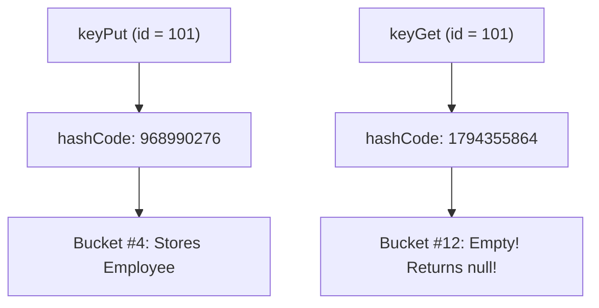

# Day 8: Employee Directory (Maps, Comparators & The hashCode Contract)

## 📌 Summary
A complete Employee Directory System in Java demonstrating:
- **`HashMap` Fast Lookup**: Constant-time $O(1)$ search by employee ID.
- **Frequency Counting via `Map.merge()`**: Clean and modern headcount aggregation with `Integer::sum`.
- **`TreeMap` Department Report**: Sorted departmental groupings ordered naturally by alphabetical keys.
- **Natural Ordering (`Comparable`)**: Entities sorted by employee ID.
- **Chained `Comparator`**: Multi-level sorting for top-5 salaries (Salary DESC $\rightarrow$ Name ASC $\rightarrow$ ID ASC).
- **The `equals()` / `hashCode()` Contract**: A live reproduction of the classic "missing `hashCode()`" bug and its fix.

---

## 📁 Project Structure

```text
DailyTask/
└── Day08/
    ├── pom.xml                                       # Maven configuration (Java 21, exec plugin)
    ├── README.md                                     # Revision guide & concept notes
    └── src/
        └── main/
            └── java/
                └── com/
                    └── hcl/
                        └── employee/
                            ├── Employee.java          # Model implementing Comparable by id
                            ├── EmployeeDirectory.java # Core map operations, merge & comparator chains
                            ├── BuggyEmployeeKey.java  # Key with equals() but missing hashCode()
                            ├── FixedEmployeeKey.java  # Key properly overriding both equals & hashCode
                            └── EmployeeApp.java       # Main demonstration runner
```

---

## 🧠 Core Concepts for Quick Revision

### 1. Map Implementations Comparison

| Feature | `HashMap` | `TreeMap` | `LinkedHashMap` |
|---|---|---|---|
| **Underlying Structure** | Hash table (array of buckets + red-black trees) | Red-Black Tree | Hash table + Doubly-linked list |
| **Ordering** | No guarantee (arbitrary) | **Sorted by natural order or `Comparator`** | **Insertion order** (or access order) |
| **Lookup Time** | $O(1)$ average | $O(\log n)$ | $O(1)$ average |
| **`null` Keys?** | 1 `null` key allowed | **No** (throws `NullPointerException`) | 1 `null` key allowed |
| **Use Case** | Fast lookups, general mapping | Sorted reports, range queries (`subMap`, `headMap`) | LRU Caches, preserving insertion sequence |

---

### 2. Frequency Counting with `Map.merge()`

Instead of verbose `contains()`, `get()`, or `put()` boilerplate:

```java
// Modern Java 8+ frequency count:
deptCounts.merge(emp.getDepartment(), 1, Integer::sum);
```
- **How it works**:
  - If the department key does **not** exist yet: inserts `key` with initial value `1`.
  - If the department key **already** exists: applies `Integer::sum(existingCount, 1)` and stores the updated count.

---

### 3. `Comparable` vs. `Comparator`

| Feature | `Comparable<T>` | `Comparator<T>` |
|---|---|---|
| **Interface** | `java.lang.Comparable` | `java.util.Comparator` |
| **Method** | `compareTo(T o)` | `compare(T o1, T o2)` |
| **Purpose** | Defines **natural** ordering (single default order). | Defines **custom / alternative** ordering schemes. |
| **Location** | Implemented directly inside the domain class (`Employee`). | Created as external instances or lambda expressions. |
| **Chaining** | No built-in chaining. | Rich chaining methods: `.reversed()`, `.thenComparing()`. |

#### Chained Comparator in Day 8:
```java
Comparator<Employee> topSalaryComparator = Comparator
        .comparingDouble(Employee::getSalary).reversed() // Primary: highest salary first
        .thenComparing(Employee::getName)                // Tie-breaker 1: alphabetical name
        .thenComparingInt(Employee::getId);              // Tie-breaker 2: id
```

---

### 4. The `equals()` and `hashCode()` Contract Explained

#### The Rule:
> **If two objects are equal according to `equals(Object)`, they MUST produce the exact same integer from `hashCode()`.**

#### What Happens When You Break the Contract?
In `HashMap`, keys are routed to storage buckets using the calculation:
$$\text{bucketIndex} = \text{hashCode(key)} \ \& \ (n - 1)$$



1. **Bug**: In [**`BuggyEmployeeKey.java`**](file:///d:/HCLTech/DailyTask/Day08/src/main/java/com/hcl/employee/BuggyEmployeeKey.java), `equals()` checked `id == that.id`, but `hashCode()` was omitted.
2. Two separate key instances with `id = 101` inherited `Object.hashCode()`, yielding different memory-based hash codes.
3. When searching with `keyGet`, the `HashMap` calculated the bucket index using `keyGet.hashCode()`, looking into the **wrong bucket** and returning **`null`**!
4. **Fix**: In [**`FixedEmployeeKey.java`**](file:///d:/HCLTech/DailyTask/Day08/src/main/java/com/hcl/employee/FixedEmployeeKey.java), both `equals()` and `hashCode()` are implemented using `id`:
   ```java
   @Override
   public int hashCode() {
       return Objects.hash(id);
   }
   ```
   Both key instances now resolve to the exact same hash code and bucket, retrieving the employee successfully.

---

## 🛠️ How to Build and Run

### Option 1: Apache Maven (Recommended)
From `DailyTask/Day08`:
```powershell
mvn clean compile exec:java
```

### Option 2: Standard `javac` & `java`
From `DailyTask/Day08`:
```powershell
# Compile all source files into target/classes
javac -d target/classes src/main/java/com/hcl/employee/*.java

# Run EmployeeApp
java -cp target/classes com.hcl.employee.EmployeeApp
```

---

## 🚀 Push Day 8 to GitHub

From the repository root (`d:\HCLTech`):

```powershell
cd d:\HCLTech

# Stage Day 8 files
git add DailyTask/Day08

# Commit changes
git commit -m "feat: complete Day 8 employee directory task with Map operations and hashCode contract demo"

# Push to GitHub
git push origin main
```
