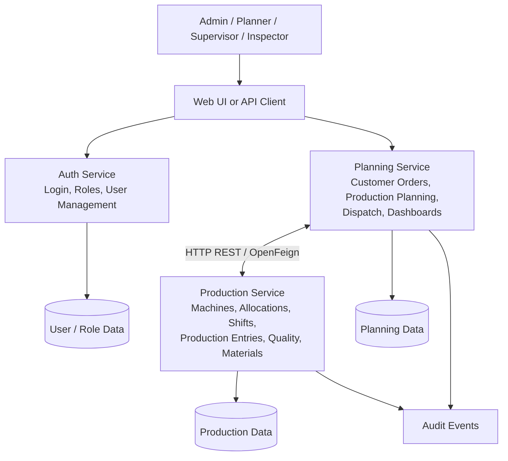
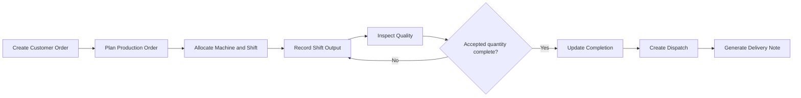
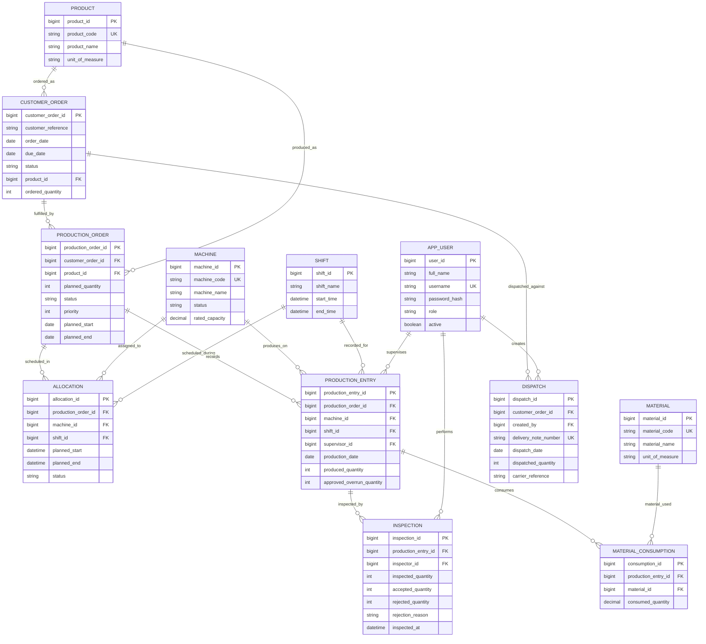

# Manufacturing Production & Order Tracking System

A manufacturing management application that tracks customer orders from order placement through production planning, machine allocation, shift-wise output, quality inspection, raw-material consumption, and final dispatch. The system is designed to give administrators, production planners, supervisors, and quality inspectors a shared view of factory operations.

> **Project level:** Advanced  
> **Domain:** Manufacturing  
> **Architecture:** Microservices-oriented (planning and production services, plus authentication)  
> **API base path:** `/api/v1`

---

## Table of Contents

- [Project Objectives](#project-objectives)
- [User Roles](#user-roles)
- [Core Modules](#core-modules)
- [Technology and Design Concepts](#technology-and-design-concepts)
- [System Architecture](#system-architecture)
- [ER Diagram](#er-diagram)
- [Functional Requirements](#functional-requirements)
- [Non-Functional Requirements](#non-functional-requirements)
- [Core Business Rules](#core-business-rules)
- [REST API Overview](#rest-api-overview)
- [Key Metrics](#key-metrics)
- [Getting Started](#getting-started)
- [Suggested Repository Structure](#suggested-repository-structure)
- [Future Enhancements](#future-enhancements)

---

## Project Objectives

1. Track customer orders and their production progress in one system.
2. Convert customer demand into production orders and schedule work on factory machines.
3. Capture production output by shift and machine.
4. Record inspection results, rejected quantities, and rejection reasons.
5. Track raw-material consumption against production.
6. Dispatch completed quantities and generate delivery notes.
7. Provide dashboards for order completion, machine efficiency, and Overall Equipment Effectiveness (OEE).
8. Maintain an auditable history of important changes.

## User Roles

| Role | Responsibilities |
|---|---|
| **Admin** | Manage users, products, machines, shifts, and master data; review dashboards and audit history. |
| **Production Planner** | Manage customer orders, create production orders, schedule machines, monitor progress, and dispatch completed goods. |
| **Supervisor** | Record shift-wise production output and raw-material consumption. |
| **Quality Inspector** | Inspect produced quantities and record accepted/rejected units with reasons. |

Access to each operation should be controlled by role-based authorization.

## Core Modules

| Module | Service | Main responsibilities |
|---|---|---|
| M1. Authentication & Users | `auth-service` | Login, user management, roles, authorization, audit identity. |
| M2. Orders & Planning | `planning-service` | Customer orders, production-order planning, scheduling, dispatch, planning dashboard. |
| M3. Shop Floor & Machines | `production-service` | Machine master data, allocations, shifts, production entries, material consumption. |
| M4. Quality | `production-service` | Inspection records, rejected quantities, rejection reasons, quality summaries. |
| M5. Dispatch & Dashboard | `planning-service` | Dispatch records, delivery notes, order completion and efficiency dashboards. |

The table describes the proposed logical service boundaries. A deployment may use separate databases per service; if the project uses one shared database during development, enforce service ownership in the application and document that choice.

## Technology and Design Concepts

The original project specification identifies Java-oriented design concepts but does not lock a complete framework or database. Confirm the exact versions and infrastructure in the implementation before adding them here.

- **Strategy pattern — `SchedulingStrategy`:** Supports scheduling policies such as earliest due date or priority.
- **Factory pattern — `ReportFactory`:** Creates the appropriate report type.
- **Builder pattern — `DeliveryNote`:** Builds a delivery note from dispatch and order details.
- **Sealed `OrderStatus`:** Restricts the permitted order-status variants when using a Java version that supports sealed types.
- **Records:** Suitable for immutable request/response DTOs and compact data carriers.
- **Streams:** Can aggregate production data for efficiency and OEE calculations.
- **`CompletableFuture`:** Can run independent dashboard/report tasks asynchronously where appropriate.
- **OpenFeign:** Supports typed HTTP communication between planning and production services.

Potential implementation stack (confirm before treating as final): Java with Spring Boot, REST APIs, OpenFeign, and a relational database. Add the actual frontend, database, authentication mechanism, migration tool, build tool, and deployment environment once selected.

---

## System Architecture

The system is organized around a client/API layer and three logical services. The planning service communicates with the production service through an HTTP client such as OpenFeign. The authentication service manages identities and role information.



### Typical order-to-dispatch flow



### Service responsibilities

- **Auth Service:** authenticates users and enforces role-based access.
- **Planning Service:** owns customer-order and production-planning workflows, dispatch, and planning-oriented dashboards.
- **Production Service:** owns machine/shift operations, production entries, inspection data, and material consumption.
- **Database ownership:** ideally each service owns its own schema/database. Cross-service references should use stable IDs rather than direct cross-database joins.
- **Audit:** record who changed what and when. Audit events should include the affected entity, action, actor, timestamp, and relevant before/after values, subject to data-retention policy.

---

## ER Diagram

The following ER diagram represents the main business entities and their relationships. It is a logical model; adjust optionality, keys, and table names to match the implemented schema.



### ER design notes

- A customer order can be fulfilled by multiple production orders, and dispatch may happen in multiple shipments.
- Machine allocation records should include start/end timestamps to validate scheduling conflicts.
- `PRODUCTION_ENTRY` records the quantity reported for a particular production order, machine, shift, date, and supervisor.
- An inspection may be split into multiple records if partial or repeated inspections are supported.
- The specification's original entity list does not explicitly include `MATERIAL` and `MATERIAL_CONSUMPTION`; these are added to support the raw-material-consumption feature.
- Store passwords as secure hashes, never as plain text.
- In a multi-service implementation, `app_user` and other cross-service references may be represented as IDs rather than physical foreign keys across separate databases.

---

## Functional Requirements

| ID | Requirement | Acceptance criteria |
|---|---|---|
| FR1 | Manage master data | Admin can create, update, deactivate, and view products, machines, shifts, and users according to permissions. |
| FR2 | Manage customer orders | Authorized users can create and view customer orders with product, ordered quantity, order date, and due date. |
| FR3 | Create production orders | Planner can convert customer demand into one or more production orders with planned quantities and schedules. |
| FR4 | Allocate machines | Planner can allocate a machine and shift to a production order; the system rejects overlapping allocations for the same machine. |
| FR5 | Record shift output | Supervisor can submit production output against a production order, machine, shift, and production date. |
| FR6 | Enforce planned quantity | The system blocks output beyond the planned quantity unless an authorized approval is recorded. |
| FR7 | Record quality inspection | Inspector can record inspected, accepted, and rejected quantities, along with rejection reasons. |
| FR8 | Track raw materials | Supervisor or authorized staff can record material consumption against production entries. |
| FR9 | Calculate completion | The system recalculates production-order and customer-order completion percentages from valid production/quality data. The chosen rule must be documented. |
| FR10 | Dispatch completed goods | Planner can dispatch eligible completed quantities and create a unique delivery note. |
| FR11 | Display dashboards | Authorized users can view order progress, output, rejects, machine efficiency, and OEE summaries. |
| FR12 | Maintain audit history | The system records edits to critical records with actor, timestamp, entity, action, and change details. |
| FR13 | Enforce role permissions | Each role can access only the operations and data allowed by the authorization policy. |

## Non-Functional Requirements

| ID | Category | Requirement |
|---|---|---|
| NFR-P1 | Integrity / Approval | Production output must not exceed planned quantity unless an authorized overrun approval is recorded. |
| NFR-P2 | Data governance | Shift data becomes locked after 24 hours. Corrections after lock must follow an authorized correction/unlock workflow and remain audited. |
| NFR-P3 | Performance | Dashboard data should refresh within 30 seconds under the agreed normal operating load. Define the test data volume and concurrency for verification. |
| NFR-P4 | Auditability | All edits to critical records must be auditable, including actor, time, action, and before/after values where applicable. |
| NFR-S1 | Security | Authenticate users, enforce role-based access, protect secrets, and use HTTPS in deployed environments. |
| NFR-S2 | Data protection | Store password hashes, validate inputs, and avoid exposing credentials or sensitive details in logs. |
| NFR-R1 | Reliability | Failed cross-service calls must return controlled errors and support safe retry where the operation is idempotent. |
| NFR-M1 | Maintainability | Keep service responsibilities, APIs, validation, and business rules modular and documented. |
| NFR-U1 | Usability | Forms should validate required fields and show clear, actionable errors to users. |
| NFR-SC1 | Scalability | Production-entry and dashboard workloads should be able to scale without changing core business rules. |

---

## Core Business Rules

1. **Machine scheduling:** an active allocation must not overlap another active allocation on the same machine. Define whether setup/maintenance buffers are required.
2. **Production quantity:** output above the remaining planned quantity requires an explicit approval record. Do not rely only on a UI check; validate on the server and database transaction path.
3. **Shift lock:** after 24 hours from the shift's defined close time, entries are locked for normal editing. Authorized corrections must be auditable.
4. **Quality reconciliation:** validate that accepted quantity plus rejected quantity equals inspected quantity, and that inspected quantity does not exceed the recorded produced quantity for the applicable scope.
5. **Dispatch eligibility:** dispatched quantity cannot exceed the available accepted, undispatched quantity for the relevant customer order.
6. **Completion percentage:** define whether completion is based on produced quantity, accepted quantity, or dispatched quantity. For quality-controlled manufacturing, accepted quantity is usually a useful production-completion measure, while dispatch progress should be tracked separately.
7. **Concurrency:** update quantities transactionally to prevent simultaneous requests from exceeding the plan or dispatchable balance.
8. **Idempotency:** consider idempotency keys for dispatch creation and other operations where retries could create duplicate records.

## REST API Overview

Base path: `/api/v1`

| Method | Endpoint | Purpose |
|---|---|---|
| `POST` | `/orders` | Create a customer order. |
| `POST` | `/production-orders` | Create a production order from customer demand. |
| `POST` | `/shifts/{id}/entries` | Submit a shift production entry for the identified shift. The request should include the production order and machine IDs. |
| `POST` | `/dispatches` | Create a dispatch and delivery note. |

Suggested additional endpoints:

- `GET /orders/{id}` — view order details and progress.
- `GET /production-orders/{id}` — view production plan, allocations, output, and quality summary.
- `POST /allocations` — allocate a machine and shift.
- `POST /inspections` — record quality inspection.
- `POST /material-consumptions` — record raw-material consumption.
- `GET /dashboard/oee?from=YYYY-MM-DD&to=YYYY-MM-DD` — retrieve OEE metrics for a date range.

For each endpoint, document request/response examples, status codes, authentication requirements, validation rules, and idempotency behavior.

## Key Metrics

- **Order completion %:** accepted quantity divided by ordered or planned quantity, multiplied by 100; specify the denominator used for each dashboard.
- **Reject rate %:** rejected quantity divided by inspected quantity, multiplied by 100. If inspected quantity is zero, return “not available” rather than dividing by zero.
- **Production attainment %:** actual valid output divided by planned output, multiplied by 100.
- **Availability:** operating time divided by planned production time.
- **Performance:** ideal cycle time × total count divided by operating time.
- **Quality:** good count divided by total count.
- **OEE:** availability × performance × quality. Use consistent time windows, units, and definitions; do not substitute production attainment for OEE.

## Getting Started

The commands below are a template, not a guaranteed one-command startup. Adapt them to the actual repository, configured database, and service names.

### Prerequisites

- JDK version compatible with the project
- Maven or Gradle, depending on the build configuration
- A supported relational database, if configured
- Git
- API client such as Postman or an equivalent tool

### Run locally

1. Clone the repository.
2. Configure each service's database connection and environment variables.
3. Configure authentication secrets through environment variables or a secrets manager; do not commit secrets.
4. Apply database migrations or initialize the required schemas.
5. Start the authentication, production, and planning services in the required order.
6. Start the frontend, if included.
7. Test the endpoints with an API client and verify role permissions.

Example commands for Maven-based Spring Boot services (run from each service directory):

```bash
./mvnw spring-boot:run
```

On Windows, if the Maven wrapper is present:

```powershell
.\mvnw.cmd spring-boot:run
```

### Configuration checklist

- Database URL, username, and password for each service
- Authentication signing key / identity-provider settings
- Service base URLs used by OpenFeign
- CORS origins, if a browser frontend is used
- Logging level and audit retention policy
- Time zone and factory shift calendar
- Database migration configuration

---

## Suggested Repository Structure

```text
manufacturing-production-order-tracking/
├── auth-service/
│   ├── src/
│   └── pom.xml
├── planning-service/
│   ├── src/
│   └── pom.xml
├── production-service/
│   ├── src/
│   └── pom.xml
├── frontend/                  # optional
├── docs/
│   ├── architecture.md
│   ├── er-diagram.md
│   └── api-specification.md
├── .env.example               # placeholders only; no real secrets
└── README.md
```

## Future Enhancements

- Barcode/QR-based work-in-progress tracking
- Preventive maintenance and machine downtime logging
- Inventory reorder alerts and supplier tracking
- ERP integration
- Notifications for overdue orders and quality thresholds
- Exportable production, quality, and dispatch reports
- Role-specific dashboards and configurable approval workflows
- Automated tests for scheduling conflicts, quantity limits, shift locks, and dispatch balances

---

## Project Status

**Documentation baseline:** Requirements, architecture, data model, and API outline drafted from the supplied project specification. Replace proposed fields, technology choices, and endpoints with the actual implementation details as development progresses.
